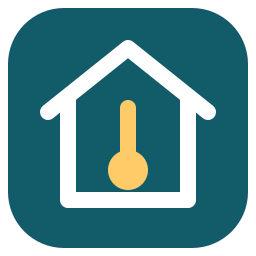

# ComfortZone Serial



Local, read-only Home Assistant telemetry from a ComfortZone EX35 through a
**Moxa NPort 5150A**, without Loggamera or its cloud. The pump requires read
requests; this integration sends selected captured read operations over UDP and
decodes temperatures, power, counters and settings. There are no register writes or heating controls.

**Status, 2026-10-26:** standalone request/reply operation was demonstrated
repeatedly with Loggamera physically unplugged, using **RS-422 / 19200 / 8N1**
and the wiring below. Captured traffic validates the EX35 `0b15` profile.
Outdoor, indoor and hot-water readings match the pump display. The owner reports HA temperature polling
already in use. The additional reads are verified against recorded captures;
standalone live trials of those reads and extended operation remain owner checks.
Automated HA tests use fake transports and recorded replies.

## Installation and setup

Use [the HA guide](docs/home-assistant.md) for manual installation or HACS custom
repository setup. The standalone repository is
[Ithanil/comfortzone-serial-hass](https://github.com/Ithanil/comfortzone-serial-hass),
domain `comfortzone_serial`. Minimum HA version: **2026.10.2**. Version `0.1.0`
remains unreleased; local tests do not constitute official HACS/hassfest or
installation validation.

1. Configure the Moxa with the proven wiring/settings below and unplug Loggamera.
2. Direct Moxa UDP to the HA host's reachable IP and port 4001; permit inbound UDP.
3. Add **ComfortZone Serial**, entering the Moxa IP and HA listening port.
4. Keep **Send captured read requests** enabled for standalone EX35 operation.
   Setup defaults to the EX35 profile and the five reads below. Under **Configure**,
   select individual reads and adjust cycle timing or choose passive reception.

| Individual read | Default | Entities |
| --- | --- | --- |
| `temperature` | On | Nine temperatures, pump local clock and weekday |
| `power` | On | Compressor heat/electrical power, auxiliary and two total outputs |
| `counters` | On | Three energy counters and compressor/total runtime |
| `heating_settings` | On | Curve and calculated heating setting |
| `hot_water_settings` | On | Setpoint, hysteresis, extra setpoint and duration |
| `calibration` | Off | TE0–TE9 calibration adjustments |
| `ui_identity` | Off | UI software version and hardware revision code |
| `fan_settings` | Off | Normal, reduced and high fan settings |
| `compressor` | Off | Diagnostic response status; payload remains undecoded |

These are individual operations, independent of the monitor's query groups.
Selected reads create their supported entities. **Pump local clock** and
**Compressor response** are disabled by default and can be enabled manually;
existing entity choices are preserved. The five initial reads register 27 entities
(26 enabled); all nine register 43 (41 enabled). Settings are read-only sensors.
The optional compressor response entity reports **Undecoded** on a valid reply,
with exact bytes in downloadable diagnostics; no frequency/state is invented.
Entity defaults do not change the selected reads or diagnostics.

Existing entries retain their profile, polling enablement and explicit timing
and network settings. EX35 entries gain the five default reads on upgrade; old
passive/observation setups remain passive. Existing entity IDs and user disables
are preserved. The legacy RX50 profile remains passive and temperature-only.

## Proven wiring

“Pump” means the original installed cable's DB9, before any crossover. Use numbered
contacts; do not infer orientation from a connector's gender or wire colors.

| Moxa contact, in RS-422 mode | Pump contact |
| --- | --- |
| 1 TX− | 2 |
| 2 TX+ | Unconnected |
| 3 RX+ | 5, via local jumper to Moxa 5 |
| 4 RX− | 3 |
| 5 GND | 5 |

Keep the **Moxa 3–5 jumper**: leaving RX+ floating stopped reception. Leave other
contacts unused. Do not ground TX+ or select RS-232/two-wire RS-485 with this
wiring. Pin 3 would become an active output. The pump's native electrical standard
is not established; this ground-referenced use of Moxa RS-422 is empirically proven
on the tested installation, not a general ComfortZone cable specification.

Set **19200, 8N1, all flow control off, FIFO enabled**, both bias jumpers open
(150 kΩ default), no added termination. Use UDP, Moxa local listen port 4001,
packing length 0, delimiters disabled, Force Transmit **20 ms**. The actual unit
is **5150A**, not P5150A; its two-jumper arrangement and pinout are in the
[5100A quick guide](https://moxa.com/getmedia/b43d0252-add7-4bf4-987b-0f6ad8811de2/moxa-nport-5100a-series-qig-v3.5.pdf),
pages 4/6. The [research summary](docs/research.md) records the unsuccessful
RS-232 tests and how the working setup was found.

## Measurements and behavior

The EX35 profile checks command, register, payload length, pump address and
address checksums.
All nine temperature entities are enabled by default: outdoor, indoor, hot water,
flow water, return water, hot gas, exchanger outlet, evaporator inlet and exhaust
air. Earlier integration-imposed disables are removed on upgrade; explicit user
disables and the preference to disable new entities are preserved. The distinction
between display checks and reference mappings remains in the protocol documentation
only. The observed unused-channel marker −990 is
unavailable, not −99 °C. Unknown fields and general fault codes remain undecoded.

Replies are reassembled across UDP datagrams: **104 + 35 bytes is one complete
139-byte reply**. CRC failures, unrelated frames, timeouts and stale readings do
not become fresh measurements. Polling allows one request at a time, waits up to
10 seconds per read, then pauses 250 ms before advancing to the next. A new
cycle starts every 60 seconds, or after the final pause if the cycle overruns;
cycles never overlap or catch up in bursts. Freshness expires per measurement
after 120 seconds, including during silence. Timing defaults are engineering
starting points, not a cadence measured from timestamp-free logs.

Valid selected replies from another poller can also update sensors. Matching a
pending request advances only this integration's scheduler; it cannot establish
which poller caused a reply. See the [HA guide](docs/home-assistant.md) for shared
UDP forwarding and the reviewed technical settings.

Energy/runtime counters retain their decoded units and ordinary HA history, but
have no statistics state class until reset/rollover behavior is established.
Energy counters are not yet suitable for the Energy dashboard. Power and measured
temperatures support statistics. The pump clock is local text, without an invented
timezone; calibration and hysteresis use temperature-difference units.

HA owns measurement storage, history and visualization. There is no cloud call,
MQTT dependency, database or separate collector service. TCP is deferred because
UDP already supports the proven request/reply path. Diagnostic capture is optional
and passive; [replay](docs/diagnostics.md) is offline and never transmits.

## Development

Runtime, tests, fixtures, tools and docs are self-contained in this repository.
The original captures and detailed hardware history live in the separate
[investigation repository](https://github.com/Ithanil/re_loggamera).
See [protocol](docs/protocol.md), [fixture provenance](tests/data/README.md),
[reference licenses](docs/references.md) and [distribution](docs/distribution.md).

The shared telemetry package provides [captured reads and field decoding](docs/query-mapping.md)
for HA and the investigation repository's Moxa monitor. The monitor retains its
six query groups; HA selects the nine individual reads. Unknown regions remain
in diagnostics. Alarm/event history and advanced controller tuning are excluded.

```sh
python3 -m pytest -q --ignore=tests/ha
python3 -m tools.capture --help
python3 -m tools.replay --help
```

Use Python 3.13+ for protocol/tools tests; the pinned HA harness requires Python
3.14. Full commands are in the [HA guide](docs/home-assistant.md#development-verification).
The [validation checkpoint](docs/validation.md) records the passing integration
tests. Tests use synthetic and captured fixtures, fake transports and localhost only.
They never contact the live Moxa/pump. New code is [MIT licensed](LICENSE).
